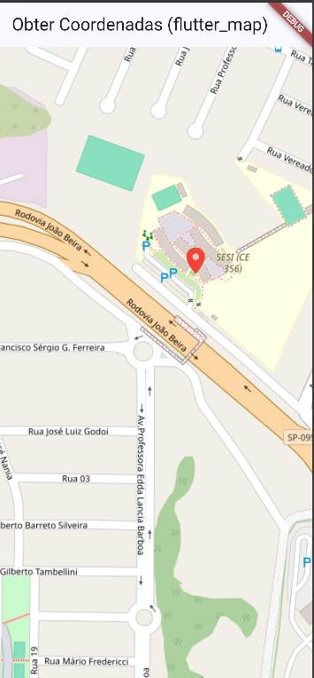

# 📍 Aplicativo de Mapa

Aplicativo desenvolvido em Flutter seguindo o tutorial proposto na atividade.

## 🎯 Objetivo

O aplicativo apresenta um mapa e permite que o usuário clique em um ponto para obter sua localização.

Ao clicar no mapa, são exibidas:

- Latitude
- Longitude

## 🗺️ Aplicativo funcionando



## 📱 APK

O APK do aplicativo está disponível na pasta `assets`.

## 🛠️ Tecnologias utilizadas

- Flutter
- Dart
- Google Chrome
- Mapa
- GitHub

## ▶️ Como executar

Clone o repositório:

```bash
git clone URL_DO_SEU_REPOSITORIO